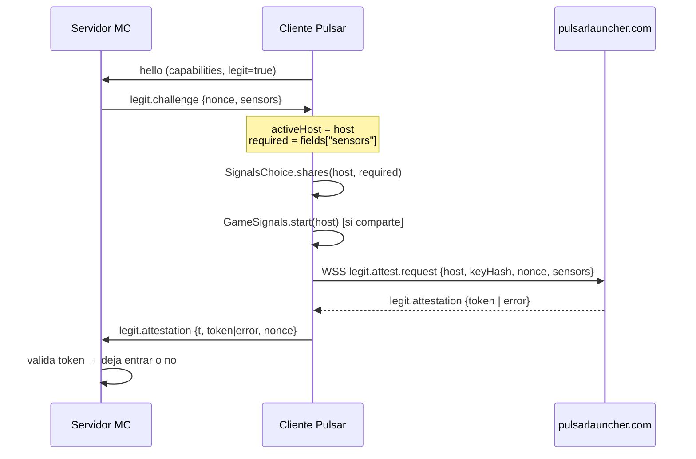

# El módulo `legit` — anatomía del "anticheat" de Pulsar

**Versión analizada:** 0.2.26-beta · **Código:** 1.706 líneas en 15 clases (`engine-api`) + 6 clases en `bootstrap/legit`
**Método:** lectura completa del bytecode decompilado y de los call sites en los mixins de 1.8.9 y 26x

---

## 0. Qué es y qué no es

`legit` **no es un anticheat del servidor de Minecraft**. Es un **sistema de atestación de cliente** operado por Pulsar, con tres funciones distintas que conviene no mezclar:

| Función | Quién la pide | Qué consigue |
|---|---|---|
| **A. Atestación de integridad** | El servidor de Minecraft | Un token que dice "este cliente es el build oficial y su bytecode coincide" |
| **B. Telemetría conductual** | El servidor de Minecraft | CPS, varianza de apuntado, distancias de golpe, estado del ratón |
| **C. Control activo** | El servidor de Minecraft | Capar CPS y **descartar clics** por encima del límite |

Además hay un cuarto componente que se suele confundir con `legit` pero es independiente:

| **D. `StaffXrayGate`** | El servidor, con doble firma | Permite al staff ordenar ocultar bloques temporalmente |

La diferencia clave frente a un anticheat convencional: **no hay servidor de Pulsar en la decisión de juego**. El servidor de Minecraft pregunta, Pulsar firma, y el servidor de Minecraft decide. Pulsar actúa como **notario**, no como juez.

---

## 1. Arquitectura de tres canales

```
┌─────────────────┐   1. canal de packs (plugin messaging "pulsar:v1")
│  Servidor MC    │──────────────────────────────────────────────┐
│  (Paper/Spigot) │                                              │
└─────────────────┘   2. WebSocket rt.pulsarlauncher.com         │
        │                (Bearer = token de Pulsar)              ▼
        │                                          ┌──────────────────────┐
        └─────────────────────────────────────────▶│  Cliente Pulsar      │
                                                   │  LegitSession        │
                                                   │  ├─ EntryPass        │
                                                   │  ├─ GameSignals      │
                                                   │  │   ├ ClickSensor   │
                                                   │  │   ├ AimSensor     │
                                                   │  │   └ ReachSensor   │
                                                   │  ├─ ProbeEngine      │
                                                   │  └─ SelfGuard        │
                                                   └──────────────────────┘
                                                              │
                     ┌────────────────────────────────────────┘
                     ▼  3. POST /api/v1/legit/mark (HTTP)
              ┌─────────────────┐
              │ pulsarlauncher  │  ← estado y puntuación de la cuenta
              │   .com          │
              └─────────────────┘
```

**El canal 1 es el importante y el que casi nadie espera:** el servidor de Minecraft habla directamente con el cliente de Pulsar a través de *plugin messaging* de Minecraft, el mismo mecanismo que usan los plugins de Spigot para hablar con mods del cliente. No hace falta ningún servidor de Pulsar para lanzar el challenge.

El **canal 2** solo se usa para firmar la respuesta (`legit.attest.request`) y para el relay social.

El **canal 3** es donde vive la puntuación que el operador consulta.

---

## 2. El identificador de conexión: `ConnectionIdentity`

Antes de entender el challenge hay que entender contra qué se valida. `ConnectionIdentity` captura tres cosas en el momento de conectar:

```java
public static void connecting(String typed) {
   keyHash   = null;
   typedHost = addressOf(typed);   // "mc.ejemplo.com"  (sin puerto, minúsculas)
   host      = hostOf(typed);      // igual pero solo si es un dominio válido
   PulsarPlayers.room(typedHost);
}

public static void encryptingWith(PublicKey key) {
   keyHash = key == null ? null : sha256(key.getEncoded());
}
```

- **`typedHost`**: lo que el jugador escribió, normalizado (`addressOf` quita puerto, corchetes de IPv6 y puntos finales, y pasa a minúsculas).
- **`host`**: solo si parece un dominio real. `hostOf` **rechaza IPs** (todo dígitos y puntos) y cualquier cosa con `:`.
- **`keyHash`**: SHA-256 de la clave pública del servidor, capturada durante el handshake de cifrado de Minecraft.

Ese `keyHash` es lo que impide el ataque más obvio: **suplantar el nombre del servidor**. Si un atacante pone `mc.ejemplo.com` en su `server.properties` pero no tiene la clave privada del servidor real, `handleEncryptionRequest` producirá un `keyHash` distinto.

`ConnectionKeyMixin` está enganchado a `NetHandlerLoginClient.handleEncryptionRequest` precisamente para capturarlo.

---

## 3. Mecánica del challenge (flujo completo)



Paso a paso en `EntryPass.respond()` (104 líneas, el corazón del sistema):

```java
if (!(fields.get("nonce") instanceof String n) || n.isEmpty())
    return error("not_integral", null);          // ① sin nonce: rechazo inmediato

ClickCap.apply(fields.get("cpsCap"), fields.get("cpsCapRight"));  // ② el servidor fija el cap

String h = host.get();
if (h == null)          return error("unknown_host", n);    // ③ sin dominio válido
String k = keyHash.get();
if (k == null)          return error("no_channel", n);      // ④ sin clave observada

if (!"legit.challenge".equals(type))
    return attest(h, k, n, h.equals(GameSignals.serverId()));  // ⑤ "legit.renew"

activeHost = h;
boolean required = Boolean.TRUE.equals(fields.get("sensors"));
return signals.shares(h, required).thenCompose(share -> {     // ⑥ ¿compartir sensores?
    if (required && !share) return error("declined_sensors", n);
    if (share) GameSignals.start(h);
    return attest(h, k, n, share);
});
```

Fíjate en el orden: **el cap de CPS se aplica antes de cualquier validación**. Incluso si la atestación acaba fallando, el servidor ya ha impuesto su límite de clics en el cliente.

### Códigos de error y qué significan

| Código | Cuándo | Efecto en el jugador |
|---|---|---|
| `not_integral` | challenge sin `nonce` | rechazo |
| `unknown_host` | no hay dominio válido (IP o vacío) | rechazo |
| `no_channel` | no se capturó `keyHash` | rechazo |
| `declined_sensors` | el jugador no comparte sensores y eran obligatorios | rechazo |
| `cloud_unavailable` | el WebSocket de Pulsar no responde en 4 s | rechazo |
| `order_replayed` / `grant_expired` | orden de staff reutilizada o caducada | (solo xray) |

---

## 4. 🔴 El jugador no puede rechazar los sensores

Esto es el hallazgo más importante del módulo y **no estaba documentado en los reportes anteriores**.

`SignalsChoice` tiene una implementación por defecto que es la única que se usa:

```java
@FunctionalInterface
public interface SignalsChoice {
   CompletableFuture<Boolean> shares(String serverId, boolean requested);

   static SignalsChoice mandatory() {
      return (serverId, requested) -> CompletableFuture.completedFuture(requested);
   }
}
```

Y en `PackClient` está **fijada como constante**:

```java
private final SignalsChoice signalsChoice = SignalsChoice.mandatory();
```

Es decir: `shares()` devuelve siempre lo que el servidor pidió. Si el servidor pone `sensors: true`, el cliente comparte; si pone `false`, no. **No hay ninguna ruta de código en la que el jugador diga "no".**

El código *parece* que soporta consentimiento —existe la interfaz funcional, existe la rama `declined_sensors`, existe `EntryPass.sharing(Predicate<String> sharesWith)` como factoría— pero **nadie la cablea**. Es una abstracción preparada para un diálogo de consentimiento que no se llegó a implementar.

La única salida real del jugador es `FrameFlags.legitSensors`:

```java
public static boolean legitSensors = true;          // valor por defecto
// ...
legitSensors = o.bool("legit.sensors", true);       // desde client-options.json
GameSignals.enabled(legitSensors);
```

Es decir: `"legit.sensors": false` en `%APPDATA%\.minecraft\client-options.json`. Pero eso **no** responde `declined_sensors` al servidor: `shares()` sigue devolviendo `true`, se envía el token como si todo fuera bien, y simplemente los sensores no registran datos (`GameSignals.active == false`). El cliente miente por omisión en lugar de rechazar limpiamente.

**Consecuencias:**

1. No hay consentimiento informado. La primera vez que entras a un servidor con `sensors: true`, tus patrones de clic y apuntado se envían sin que hayas aceptado nada.
2. El único control (`legit.sensors`) es un fichero JSON que hay que editar a mano.
3. El servidor **no se enterará** de que lo has desactivado, porque la respuesta sigue siendo un token válido. Eso es un fallo de diseño: o el servidor confía en un dato que puede estar vacío sin saberlo, o el mecanismo de integridad no vale lo que promete.

---

## 5. Los sensores, uno a uno

Los tres se activan solo si `LegitWatch.host() != null` y `GameSignals.active`. Se enganchan en los mixins de Minecraft.

### 5.1 `ClickSensor` — detección de autoclicker/macro

Alimentado por `MinecraftClientClicksMixin.runTick` (1.8.9) y `MouseHandlerMixin` (26x):

```java
if (button == 0 && GameSignals.active()) {
   if (pressed) ClickSensor.press(nanos); else ClickSensor.release(nanos);
}
```

| Constante | Valor | Para qué |
|---|---|---|
| `INTERVAL_BUCKETS` | 80 × 5 ms = 400 ms | histograma de tiempo entre clics |
| `HOLD_BUCKETS` | 40 × 5 ms = 200 ms | histograma de duración de pulsación |
| `SERIES` | 128 intervalos | ventana deslizante |
| `SEQUENCE` | 6 | longitud mínima de patrón repetido |
| `TOLERANCE_NS` | 2 ms | tolerancia para considerar dos intervalos "iguales" |
| `BURST_NS` | 400 ms | solo cuentan intervalos dentro de esta ráfaga |

La detección específica de macro es `repeatsEarlier()`:

```java
private static boolean repeatsEarlier() {
   int last = seriesHead - 1 & 127;
   for (int shift = 1; shift + 6 <= seriesLength; shift++) {
      boolean same = true;
      for (int k = 0; k < 6 && same; k++) {
         long a = SERIES[last - k & 127];
         long b = SERIES[last - k - shift & 127];
         same = Math.abs(a - b) <= 2000000L;   // 2 ms
      }
      if (same) return true;
   }
   return false;
}
```

Busca **6 intervalos consecutivos que se repitan con ±2 ms de tolerancia** en cualquier desplazamiento anterior. Un humano no produce eso; un autoclicker a intervalo fijo, sí.

Se reporta `count`, `intervals[80]`, `holds[40]`, `sequences`, `repeats` y `cpsMax`.

### 5.2 `AimSensor` — detección de aimbot

Alimentado por `MinecraftMixin.runTick` con los ángulos del jugador:

```java
if (GameSignals.active()) AimSensor.tick(player.getYRot(), player.getXRot());
```

Usa **algoritmo de Welford** (media y varianza en una pasada, numéricamente estable) sobre los deltas por tick:

```java
double d1 = dy - yawMean;  yawMean += d1 / ticks;  yawM2 += d1 * (dy - yawMean);
double d2 = dp - pitchMean; pitchMean += d2 / ticks; pitchM2 += d2 * (dp - pitchMean);

float turn = (float) Math.sqrt(dy*dy + dp*dp);
if (lastWasBig && turn < 0.001F) snaps++;      // giro >30° y luego quietud
lastWasBig = turn > 30.0F;                      // SNAP_DEGREES
```

La firma del aimbot es el **snap**: un giro brusco de más de 30° seguido inmediatamente de un movimiento inferior a 0,001° (quietud casi absoluta). Eso es una corrección instantánea a la cabeza del objetivo.

Se reporta `ticks`, `yawVariance`, `pitchVariance` y `snaps`.

### 5.3 `ReachSensor` — alcance de golpe

Alimentado por `AttackReachMixin` en `PlayerControllerMP.attackEntity` (1.8.9) y `MultiPlayerGameMode.attack` (26x) — el hook que verifiqué contra el bytecode en el informe de mixins:

```java
AABB b = target.getBoundingBox();
ReachSensor.hit(player.getX(), player.getEyeY(), player.getZ(),
                b.minX, b.minY, b.minZ, b.maxX, b.maxY, b.maxZ);
```

Calcula la **distancia del ojo al AABB** (no al centro de la entidad), que es la métrica correcta:

```java
double dx = Math.max(0, Math.max(minX - x, x - maxX));   // 0 si está dentro
double dy = Math.max(0, Math.max(minY - y, y - maxY));
double dz = Math.max(0, Math.max(minZ - z, z - maxZ));
return Math.sqrt(dx*dx + dy*dy + dz*dz);
```

Histograma de 160 buckets de 0,05 (hasta 8 bloques) y calcula en el reporte **`max`, `p50` y `p95`**. El p95 es lo interesante: un jugador con reach normal tiene la mediana en ~3,0 y el p95 apenas lo supera; un reach hack desplaza toda la distribución.

### 5.4 `ClickCap` — el control activo

Este es el único componente que **modifica el juego en tiempo real**:

```java
public static boolean drop(int button, boolean pressed, long nanos) {
   // ...
   if (!pressed) { boolean d = DOWN_DROPPED[button]; DOWN_DROPPED[button] = false; return d; }
   if (filled >= cap) {
      long nth = presses[Math.floorMod(head - cap, 255)];
      // si nth está dentro de la ventana de 1 s → descarta el clic
   }
}
```

Reglas:
- Cap por botón, **0 a 255** (`MAX_CAP = 255`).
- El cap se fija desde el challenge (`cpsCap` / `cpsCapRight`) y **solo puede endurecerse**, nunca relajarse: `stricter(capLeft, parse(left))`.
- El clic descartado se contabiliza (`CAPPED`) y se reporta en `legit.live` y en el reporte de ventana.
- Ventana de 1 segundo deslizante sobre 255 pulsaciones.

**Efecto práctico:** si el servidor manda `cpsCap: 8` y tú haces 12 CPS, **el cliente se come 4 clics**. No es una alerta, es una limitación física del juego impuesta por el servidor. Y `ClickCap.drop()` se aplica en el mixin **antes** de que el clic llegue a `Minecraft.clickMouse()`, así que el juego nunca los ve.

---

## 6. `ProbeEngine` — atestación de bytecode

Es la parte criptográfica. El servidor pide hashes de código cargado:

```java
public List<String> classBytes(byte[] salt, List<String> classes) {
   for (String name : classes)
      out.add(HEX.formatHex(answer(salt, normalize(source.classBytes(name)))));
}
public List<String> jarRanges(byte[] salt, List<Range> ranges) { /* jar/offset/length */ }

public static byte[] answer(byte[] salt, byte[] data) {
   MessageDigest sha = sha256();
   sha.update(salt);
   sha.update(data);
   byte[] full = sha.digest();
   byte[] out = new byte[16];                        // solo 16 bytes
   System.arraycopy(full, 0, out, 0, 16);
   return out;
}
```

Dos detalles que importan:

**`normalize()`** — antes de hashear, sustituye los UUIDs incrustados en los class bytes (30 bytes + 6 de sufijo por UUID) para que el mismo código con distinto UUID dé el mismo hash. Sin esto, un mixin generado por servidor tendría hashes distintos por jugador.

**`LoadedCodeSource`** — el `Source` que alimenta al motor solo puede leer dos cosas:

```java
public byte[] classBytes(String className) { return this.loader.definedClassBytes(className); }
public Path  jar(String fileName)          { return this.jars.get(fileName); }
```

Solo clases **ya definidas por el `GameClassLoader`** y solo JARs **de su propio classpath**. No puede leer ficheros arbitrarios del disco. El `salt` es del servidor y aleatorio por petición, así que las respuestas no se pueden precalcular ni reutilizar (replay).

Limitación real: **16 bytes de SHA-256 truncado** dan 128 bits de resistencia a colisión por respuesta, pero como el servidor eligió el salt, tampoco puede un atacante elegir el código a posteriori. Es un diseño correcto aunque conservador.

`BootSeal.exam()` es el complemento estático en el momento del arranque:

```java
Exam(clientVersion, mcVersion, buildId, os, bootHash, mojangSha1, origins)
```

- `bootHash` (`ProbeEngine.bootHash`): SHA-256 de la lista ordenada `nombre<TAB>sha256` de todos los JARs de Pulsar. Es una **raíz de confianza** de todo el conjunto.
- `mojangSha1`: SHA-1 de `<mcVersion>.jar`. Debe ser `3870888a…b908` para 1.8.9.
- `origins`: argumentos JVM inyectores detectados (`-javaagent`, `-agentlib`, `-agentpath`, `-Xbootclasspath`, `--patch-module`, `-Djava.system.class.loader`) más `game-sha1-mismatch`.

---

## 7. `SelfGuard` y `Guard` — lo que se envía cada 5 segundos

`LegitSession` programa `sendReport()` cada **5 s** con el resultado de `SelfGuard.get()`:

```java
d.put("loadedClasses",    loader.definedCount());
d.put("unknownClasses",   watch.report().get("unknownClasses"));    // límite 16
d.put("redefinedClasses", watch.report().get("redefinedClasses"));
d.put("agents",           BootSeal.injectingArgs());
d.put("attachDisabled",   attachDisabled());
d.put("guardFlags",       flags);   // attach-enabled, attach-listener, class-watch-off
d.put("guard",            guard.scan().toJson());
d.put("mice",             MouseLock.current().report());
```

Y `guard.scan()` es **distinto por plataforma**:

| | `LinuxGuard` | `WindowsGuard` |
|---|---|---|
| Fuente | `/proc/self/maps` | snapshot de módulos (`EnumProcessModules`) |
| Filtro | solo `.so`, descarta los de root vía `uid_map` | catálogo WinTrust + directorios de sistema |
| Depurador | `TracerPid` | `IsDebuggerPresent` + `CheckRemoteDebuggerPresent` |
| Extras | — | `foreignThreads`, `remoteOpens` |
| Verificación de firma | ❌ | ✅ contra catálogo de Microsoft (`WTD_CHOICE_CATALOG`) |
| Se envía | `name`, `sha256` | `name`, `sha256`, `signed` |

**Importante y comprobado:** solo viaja el **nombre** del módulo, nunca la ruta (`measure()` recorta con `lastIndexOf(92|47)`). Eso acota bastante la fuga.

`KnownModules` es una lista blanca de ~80 nombres (drivers de GPU, overlays, LWJGL, `discord_hook.dll`, `msiafterburner.dll`, `obs-vulkan.dll`…) con lógica de versión: `libGL.so.1` se compara contra `libgl.so` recortando en `.so.`.

`ClassWatch` es un `ClassFileTransformer` que marca:
- clases definidas **fuera** del classpath conocido (`unknownClasses`)
- clases **redefinidas** en caliente (`redefinedClasses`)

Es decir: si un mod de terceros se cuela en el classpath, se ve.

---

## 8. `StaffXrayGate` — el control de moderación

No es telemetría, es una **capacidad concedida al staff**. Flujo:

1. El servidor de Minecraft envía `staff.xray` con dos objetos firmados: `order` y `grant`.
2. `order` va **firmado por la clave de la network** (la comunidad/red de servidores).
3. `grant` va **firmado por Pulsar** (la clave embebida en el JAR).
4. Ambas firmas se verifican con `PackVerifier.verify(Json.canonical(...), sig, key)`.

Validaciones que aplica (`verify()`, ~90 líneas):

| Comprobación | Error |
|---|---|
| `order.v == 1`, `order.kind == "xray"` | — |
| El registro de la network existe y coincide | `registry_unavailable`, `registry_other` |
| El servidor de destino pertenece a esa network | `other_network` |
| Firma de `order` con la clave de la network | `order_unsigned` |
| `order.uuid` == cuenta actual | `order_other_player` |
| `order.keyHash` == `keyHash` de la conexión | `order_other_connection` |
| `exp - iat <= 120 s` | `order_lifetime` |
| Firma de `grant` con la clave de Pulsar | `grant_unsigned` |
| `grant.kind == "staff"`, misma network y uuid | `grant_other` |
| `grant` vigente, `<= 900 s`, skew `±300 s` | `grant_expired` |
| `nonce` no visto antes (`SEEN` HashSet) | `order_replayed` |
| `hide` ≤ 256 elementos | — |

Si todo pasa, `accept()` fija `activeUntilMs = arrivalMs + validMs` y la lista de bloques a ocultar.

**Valoración:** el diseño de autorización es **sólido**. Doble firma (network + Pulsar), atado a la cuenta, atado a la conexión por `keyHash`, caducidad corta, anti-replay y comprobación de pertenencia a la network. Es el componente mejor construido de todo el módulo.

**El riesgo no es el diseño, es la clave:** si se filtra la clave de firma de Pulsar (la privada, que no está en el binario), un tercero podría emitir `grant`s válidos para cualquier network. Y si se filtra la de una network, podría ordenar ocultaciones a sus propios jugadores sin que Pulsar lo autorice — aunque seguiría necesitando el `grant` de Pulsar, así que la doble firma protege.

---

## 9. La puntuación y el estado

Estados (`LegitState`): `UNKNOWN`, `INTEGRAL`, `OBSERVATION`, `NOT_INTEGRAL`, `OFFLINE`.

El estado y el score llegan del servidor de Pulsar por el WebSocket:

```java
if ("legit.status".equals(type)) setState(parseState(d.get("state")), d.get("score").intValue());
if ("legit.watch".equals(type))  LegitWatch.set(Boolean.TRUE.equals(d.get("on")));
```

Y se persisten localmente en `legit-state.json` para que el launcher muestre el indicador del HUD (`LegitIndicatorModule`). La consulta manual va por HTTP:

```
GET  /api/v1/legit/mark            → estado actual
POST /api/v1/legit/appeal {caseId, text}  → apelación (409 si ya apelaste)
```

`LegitService.status()` solo lee el fichero local si el juego está corriendo.

**Conclusión importante:** la lógica que decide si eres "íntegro" **no está en el cliente**. Está en `pulsarlauncher.com`. El cliente solo recoge y transmite.

---

## 10. Qué puede hacer y qué no

### Puede

| Capacidad | Cómo |
|---|---|
| Verificar que el cliente es el build oficial | `bootHash` + `buildId` |
| Verificar que el `client.jar` de Minecraft no está modificado | `mojangSha1` |
| Verificar bytecode concreto con challenge-response | `ProbeEngine` con salt |
| Detectar clientes de terceros o mods inyectados | `ClassWatch` (unknown/redefined) |
| Detectar depuradores y agentes JVM | `TracerPid` / `IsDebuggerPresent` / `origins` |
| Inventariar DLLs cargadas con hash y firma | `Guard` (Windows más que Linux) |
| Detectar autoclicker por periodicidad | `ClickSensor.repeatsEarlier` |
| Detectar aimbot por snaps y varianza | `AimSensor` |
| Medir reach con percentiles | `ReachSensor` |
| **Limitar CPS descartando clics** | `ClickCap.drop` |
| Permitir al staff ocultar bloques | `StaffXrayGate` |
| Expulsar de un servidor | el servidor decide según el token |

### No puede

- **No lee teclado.** Ni `SetWindowsHookEx` ni `WH_KEYBOARD` ni keycode alguno en todo el módulo.
- **No captura pantalla** ni portapapeles.
- **No lee ficheros arbitrarios.** `ProbeEngine.Source` está limitado a JARs del classpath y clases ya definidas.
- **No inyecta en otros procesos.** Sin `ReadProcessMemory` ni `ptrace`.
- **No decide la sanción.** Solo emite un token; el servidor decide.
- **No funciona sin sesión de Pulsar.** Sin token, `LegitSession.attest` devuelve `cloud_unavailable`.
- **No funciona en servidores que no lo piden.** Sin `legit.challenge`, `GameSignals.active` es `false` y los sensores no registran.

---

## 11. Cómo desactivarlo

| Nivel | Método | Efecto real |
|---|---|---|
| Total | `-Dpulsar.legit=off` | `LegitBoot.start` no hace nada: sin sesión, sin sensores, sin probes |
| Sensores | `"legit.sensors": false` en `client-options.json` | `GameSignals.active = false`: los sensores no registran, **pero el token se sigue enviando** |
| Sesión | jugar sin cuenta de Pulsar | sin `LegitSession.current()`, el handshake anuncia `legit=false` |
| Servidor | no pedirlo (sin plugin) | sin `legit.challenge` no hay nada |
| Probes | — | no configurable |

**Ojo con el nivel 2:** desactivar `legit.sensors` **no** te libra de la atestación ni del `ClickCap`, porque `ClickCap.apply` se ejecuta en `EntryPass.respond()` **antes** de mirar los sensores. El cap de CPS se aplica igual.

---

## 12. Valoración técnica

**Lo bien hecho:**

- Separación limpia de responsabilidades: notario (`LegitSession`), sensores (estado estático), política (`EntryPass`), transporte (`CloudLink`).
- `ProbeEngine` con salt por petición es el patrón correcto de challenge-response, y la superficie del `Source` está bien acotada.
- `StaffXrayGate` es de nivel producción: doble firma, binding a cuenta y conexión, anti-replay, caducidad.
- Los sensores son estadísticamente sensatos: Welford en vez de acumular, percentiles en vez de medias, normalización de UUID en el hashing.
- Falla cerrado: sin nonce, sin host, sin keyHash o sin cloud → error explícito, nunca "pasa por defecto".

**Lo mal hecho:**

1. 🔴 **No hay consentimiento.** `SignalsChoice.mandatory()` está hardcodeado. La interfaz para preguntar existe y no se usa. El jugador descubre que comparte patrones de clic y apuntado porque leyó el código, no porque se le preguntara.
2. 🟠 **Silenciar los sensores no se comunica al servidor.** El token se envía igual, así que el servidor cree que tiene datos cuando quizá no. Rompe la confianza del propio mecanismo.
3. 🟠 **`ClickCap` muta el juego sin que el jugador lo sepa.** Un cap de CPS impuesto por el servidor se materializa como clics que desaparecen.
4. 🟡 **Telemetría cada 5 s** con inventario de módulos es desproporcionada para un juego.
5. 🟡 `SEEN` (anti-replay de `StaffXrayGate`) es un `HashSet` que crece sin límite hasta el siguiente `clear()`; fuga de memoria menor en sesiones muy largas.

---

## 13. Resumen en una frase

`legit` es un **notario criptográfico de cliente** bien construido en su parte criptográfica y de autorización, mal construido en su parte de consentimiento, que en la práctica convierte la voluntad del operador del servidor en **restricciones físicas del juego** (clics descartados) y en **telemetría conductual obligatoria** (patrones de clic y apuntado) sin que el jugador tenga un mecanismo real para negarse.
